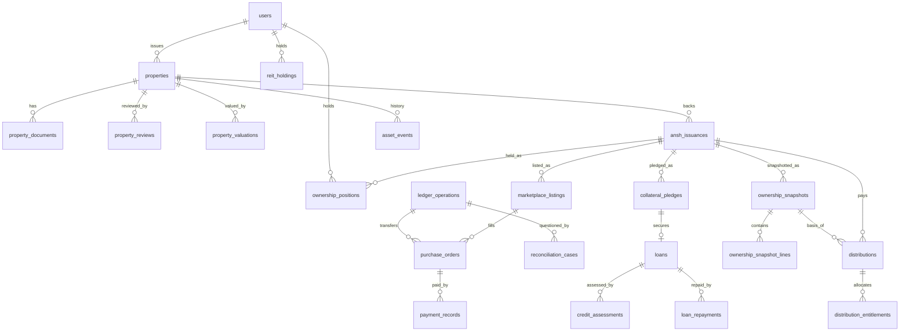

# TokANSH — Application Database Design

**Status:** Proposed for team review (first implementation)
**Scope:** The TokANSH application database only (ADR-009). Not DRUNIX's ledger or its internal YugabyteDB (ADR-008).

Companion documents:

- [`DATABASE_REFERENCE.md`](DATABASE_REFERENCE.md): every table, column, constraint and index, every enumeration, and the DML playbook. Generated from the code.
- [`../backend/README.md`](../backend/README.md): how to install, migrate, seed and test.

## 1. What existed and what this adds

Before this change the repository held specifications only: no backend code, no schema, no migrations.

This change adds:

| Area | Delivered |
|---|---|
| Models | 26 SQLAlchemy 2 tables in `backend/app/db/models/` |
| Migrations | `0001_initial_application_schema.py`, then `0002_property_issuer_proposal.py`, in `backend/alembic/versions/` (each upgrades and downgrades) |
| Rules in the database | 110+ CHECK constraints, unique keys and foreign keys that encode the business rules |
| Seed | `backend/scripts/seed_demo.py`: synthetic users, REIT holdings and an optional draft property |
| DML playbook | `backend/sql/dml_playbook.sql`: every insert and update of the demo journey |
| Tests | 60 tests: structure, migration, invariants, seed, and the playbook run end to end |

All 17 entities of `DOMAIN_MODEL.md` are covered. Nine tables are additions the documents call for but do not list; section 6 explains each.

## 2. Conventions

| Topic | Rule | Why |
|---|---|---|
| Keys | UUID strings, `varchar(36)` | API_CONTRACTS 4.3 |
| Money | Integer paise in `*_minor` columns, beside an explicit currency | ADR-015. SQLite stores `NUMERIC` as binary floating point, so decimals are not safe there |
| Ratios | Integer basis points in `*_bps` columns (6000 = 60%) | Same reason |
| ANSH quantity | Whole integers | BUSINESS_RULES 2.3 |
| Timestamps | UTC, timezone-aware; naive values are refused | API_CONTRACTS 4.5 |
| Enumerations | `varchar(40)` + CHECK | Portable to PostgreSQL / YugabyteDB YSQL |
| Deletes | Foreign keys are `RESTRICT`; nothing cascades | Financial history is never removed as a side effect |
| Defaults | Present in Python and in the database | Hand-written SQL gets the same defaults as the ORM |

The API exchanges decimal strings such as `"5000000.00"`. The backend converts to paise at the API boundary: `amount_minor = amount × 100`.

SQLite ignores foreign keys unless asked. `app/db/session.py` turns them on for every connection; always create engines through `make_engine`.

## 3. Source of truth, table by table

DRUNIX is authoritative for issuance, ownership, transfers and pledges. The tables below marked *projection* copy committed ledger state for reading and must carry the ledger reference they came from.

| Table | Role |
|---|---|
| `users`, `properties`, `property_documents`, `property_reviews`, `property_valuations` | Application-owned |
| `marketplace_listings`, `purchase_orders`, `payment_records` | Application-owned (payments simulated) |
| `loans`, `credit_assessments`, `loan_repayments` | Application-owned, simulated |
| `distributions`, `distribution_entitlements` | Application-owned (payouts simulated) |
| `reit_holdings` | Application-owned, simulated; separate asset class |
| `ledger_operations`, `reconciliation_cases`, `idempotency_records` | Application-owned record of what was sent to DRUNIX and what came back |
| `ledger_events`, `ledger_event_cursors` | Copy of consumed chaincode events, for reconciliation |
| `ansh_issuances` (`issued_quantity`, status) | **Projection** of ledger issuance |
| `ownership_positions` | **Projection** of ledger balances |
| `collateral_pledges` (status) | **Projection** of ledger pledge state, plus application valuation data |
| `ownership_snapshots`, `ownership_snapshot_lines` | **Projection**: record-date ownership obtained from DRUNIX |
| `asset_events`, `audit_events` | Application history; each row names its source |

## 4. Relationships

`reit_holdings` links only to `users`. No ANSH table references it, and a test keeps it that way (ADR-019).

## 5. Business rules the database enforces

The backend validates first. These constraints are the last line of defence: a bug in a service cannot write a row that breaks them.

| Rule | Source | How the database enforces it |
|---|---|---|
| Issued supply ≤ approved supply | Rule 3.2 | CHECK on `ansh_issuances` |
| Supply recognised only after commit | Rule 3.4 | `issued_quantity` must be 0 unless status is `CONFIRMED`; `CONFIRMED` needs a ledger transaction id |
| Issuance needs a registered property | ADR-005 | A property's ledger reference, transaction id and registration time are all present or all absent, and only on an approved property |
| Owned ≥ 0, pledged ≤ owned | Rule 4.3 | CHECKs on `ownership_positions`; available is derived, never stored |
| Projection is traceable | Rule 4.4 | `ledger_reference` and `observed_at` are mandatory |
| Amount = quantity × price | Rule 5.3 | CHECK on `purchase_orders` |
| No duplicate purchase | Rule 5.5 | Unique `idempotency_key`; `idempotency_records` detects a reused key with a different request |
| Listing never oversold | Rule 5.4 | `0 ≤ remaining_quantity ≤ quantity` |
| Order completes only with a transfer | Rule 6.1 | `COMPLETED` needs `transfer_operation_id` |
| Refund is traceable | Rule 6.3 | A `REFUND` payment must reference the original payment |
| Commit needs evidence | ADR-011, AGENTS §9 | `COMMITTED` needs `transaction_id` and `confirmed_at`; a transaction id can be stored once only |
| Unknown is not committed | Rule 6.4 | `confirmed_at` is allowed only on `COMMITTED` |
| Collateral value = quantity × unit value | Rule 8.3 | CHECK on `collateral_pledges` |
| Pledge active/released only via the ledger | Rule 8.6, 9.4 | Status needs the matching ledger operation id |
| Loan balance never negative | Rule 9.1 | `0 ≤ outstanding ≤ principal`; `REPAID` needs a zero balance |
| One distribution per period | Rule 10.5 | Unique (issuance, record date, period) |
| Record-date holdings | Rule 10.2, 10.6 | A distribution cannot be processed without a snapshot; one snapshot per issuance and record date |
| One entitlement per investor | Rule 10.5 | Unique (distribution, investor) |
| Simulated work is labelled | ADR-010 | Payments, loans, repayments and payouts must carry `simulation_flag = true` |
| Events state their source honestly | Rule 12 | An event may claim `DRUNIX_LEDGER` only with a transaction id, and only ledger events may carry one |
| No floating-point money | ADR-015 | A test fails if any `FLOAT` or `NUMERIC` column appears |

Each row has a test in `backend/tests/test_invariants.py` that tries to break the rule and expects the database to refuse.

## 6. Tables added beyond the documented entity list

| Table | Why it is needed |
|---|---|
| `property_reviews` | The approval decision, reviewer and approved supply need a record (ADR-007: approval is an application decision) |
| `property_valuations` | Rule 8.3 separates the approved collateral value from the illustrative market value, each with a source and observation time |
| `ownership_snapshots`, `ownership_snapshot_lines` | Rule 10.6 and ADR-014: the record-date ownership used for a distribution must be retained with its ledger reference |
| `credit_assessments` | The demo shows a simulated assessment result; BUSINESS_RULES 2.2 asks for calculation inputs to be kept |
| `ledger_events`, `ledger_event_cursors` | DRUNIX_INTEGRATION §11: events are consumed for reconciliation, duplicates are normal, and the consumer must resume after a restart |
| `reconciliation_cases` | Rules 6.3 and 6.4 require an explicit exception workflow |
| `idempotency_records` | API_CONTRACTS 4.7: detect a reused Idempotency-Key with different parameters |

## 7. Decisions for the team to confirm

These are places where the documents were silent or disagreed. Each is implemented as described and can be changed in a follow-up migration.

1. **Naming.** ARCHITECTURE §13 lists `issuance_records` and `blockchain_operations`. They are implemented as `ansh_issuances` and `ledger_operations`.
2. **`portfolio_snapshots` is not a table.** ARCHITECTURE §13 lists it. Current holdings are `ownership_positions`; record-date holdings are `ownership_snapshots`. A separate portfolio snapshot looked redundant.
3. **ANSH Unit (DOMAIN_MODEL 2.5) is merged into `ansh_issuances`.** `ansh_asset_id` identifies the fungible asset; there is no separate table.
4. **One status column on `ledger_operations`.** DOMAIN_MODEL 2.10 names `submission_status` and `commit_status`; API_CONTRACTS §8 defines one lifecycle. The single lifecycle is used, with `validation_code` for the raw DRUNIX result.
5. **Roles.** DOMAIN_MODEL has four roles; API_CONTRACTS §6 treats Admin/Issuer as one. All four are stored.
6. **One loan per pledge.** Enforced by a unique key. Partial release is out of scope (ADR-013).
7. **Loans are principal-only.** `interest_rate_bps` is stored but nothing accrues (Rule 9.2 permits this).
8. **Enumerations marked *proposed*** in the reference (document types, verification status, credit decision and others) fill gaps in DOMAIN_MODEL.
9. **Distribution rounding.** Each distribution records its `rounding_method`. The playbook uses "floor per holder; residual paise to the largest holder". Rule 10.5 requires the method to be documented and approved.
10. **Demo figures.** The playbook uses the illustrative values of BUSINESS_RULES (loan ₹12,00,000, LTV limit 60%, distribution ₹10,00,000). DEMO_SCRIPT 6.3 requires the final dataset to be approved.
11. **Ledger names in the playbook.** Function names follow the proposals in DRUNIX_INTEGRATION §6.2; `mychannel` and `tokansh` are example values. Use whatever the deployed chaincode exposes.

## 8. What the database does not enforce

These rules span several rows or need the ledger, so the backend services own them:

- Listing and pledge quantities ≤ available ANSH, checked against DRUNIX at execution time.
- Total owned = issued supply, and entitlements sum = declared amount. The playbook has the reconciliation queries; tests run them.
- State-machine order (for example `PAYMENT_PENDING` → `PAYMENT_SUCCEEDED`). The playbook guards each update with the expected current status in `WHERE`.
- Repayment ≤ outstanding balance; release only after full repayment.
- Entitlements calculated only from a snapshot with `is_verified = true`.
- Append-only behaviour of `audit_events` and `asset_events`.
- Role permissions.

## 9. Known limits

- Tested on SQLite only. The schema avoids SQLite-specific SQL, but PostgreSQL has not been run (ADR-009 asks for that assessment before cloud deployment).
- SQLite allows one writer at a time. WAL mode and a 5-second busy timeout are set; that suits the demo, not concurrent load.
- Nothing here has run against a live DRUNIX network. The playbook tests use stand-in transaction ids to exercise the SQL.

## 10. Change log

| Migration | Change |
|---|---|
| `0001` | Initial schema: 26 tables |
| `0002` | `properties` gains `proposed_supply` and `proposed_issue_price_minor`, the issuer's proposal sent by the UI's new-property form. Both may be empty on a `DRAFT` and are required from submission onward; the reviewer still fixes `approved_supply`, which may differ. Existing rows are backfilled from the approved supply and issue price. The demo property moves to Bengaluru to match the UI. |

## 11. Changing the schema

1. Edit the models in `backend/app/db/models/`.
2. `alembic revision --autogenerate -m "describe the change"` and review the generated file.
3. `python -m scripts.gen_db_reference` to refresh the reference.
4. `pytest`. The suite fails if the migration and models differ or the reference is stale.

On SQLite, migrations run with foreign keys switched off so batch mode can rebuild a referenced table, then check every reference before finishing (`alembic/env.py`). A migration that would leave a broken reference fails instead of committing.
